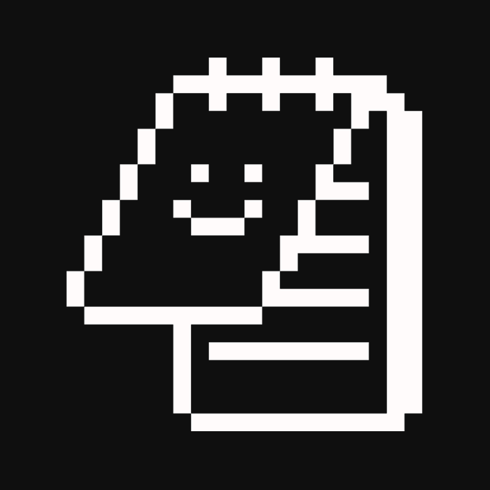
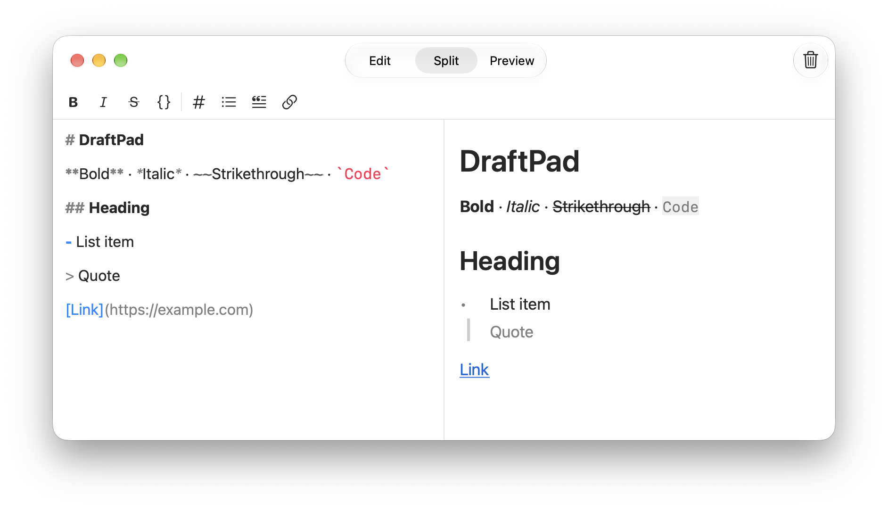
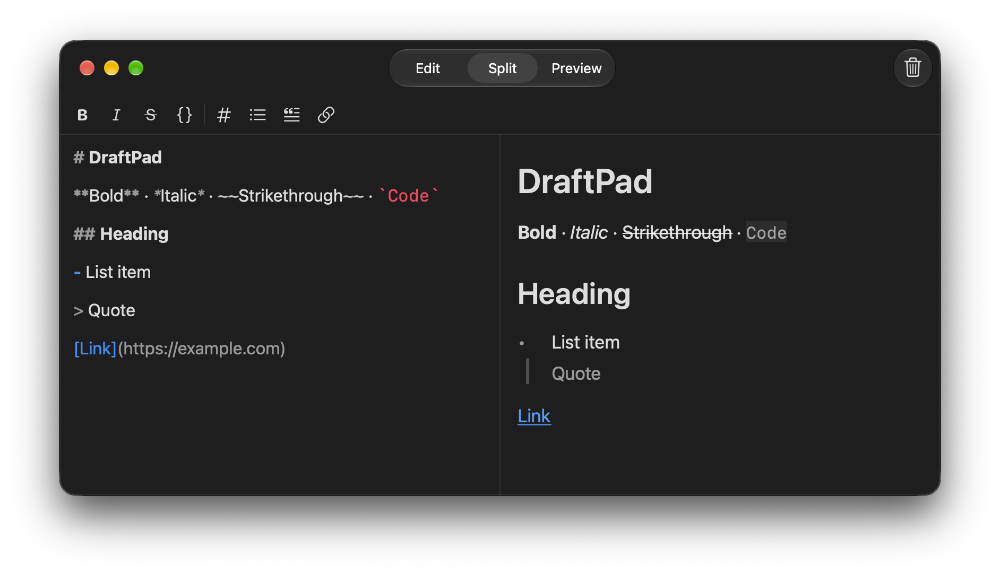

# DraftPad

<p align="center">
  
</p>

<p align="center">
  A minimal scratchpad for macOS.
  <br>
  Quickly write something down, then clear it when you're done.
</p>

## Preview

<p align="center">
  
  
</p>

## Features

- Minimal Markdown editor
- Live preview
- Light and dark appearance
- Quick note clearing
- Native macOS interface

## Requirements

- macOS
- Xcode

## Getting Started

1. Clone the repository:
   ```bash
   git clone https://github.com/anxrhy/DraftPad.git
   ```
2. Open `DraftPad.xcodeproj` in Xcode.
3. Build and run.

## License

DraftPad is licensed under the [MIT License](LICENSE).